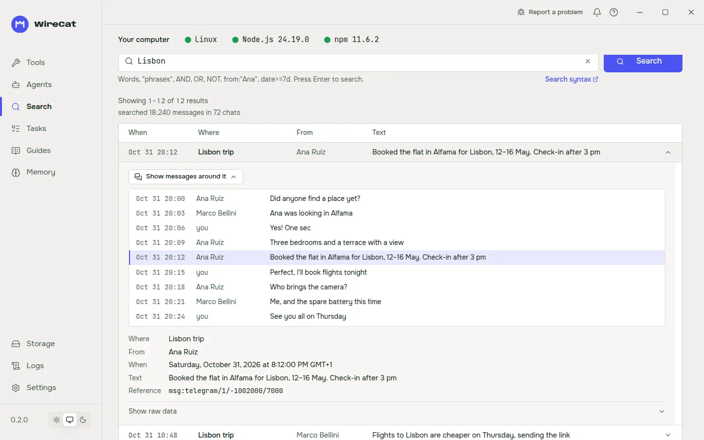

# WireCat — everything you've said, ready for your agent

Connect the AI agent you already use — Claude Code, Codex, Cursor, Gemini CLI or any CLI or MCP client —
to your Telegram and WhatsApp chats, mail, meetings, documents, calendar and notes. Free, open-source tools
that keep everything on your computer, with local search, source references and limits you set.

**Start with Telegram:** `npm install -g @wirecat/tg-cli`, then follow the
[five-minute guide](https://wirecat.dev/en/docs/tg). Or [download WireCat Desktop](https://wirecat.dev/en/download)
to install and connect the tools without a terminal. Docs for every tool: [wirecat.dev](https://wirecat.dev).

<picture>
  <source media="(prefers-color-scheme: dark)" srcset="https://raw.githubusercontent.com/WireCatLabs/.github/main/profile/wirecat-search-hit-dark-en-1440x900.webp">
  
</picture>

## Tools

| Tool | What it gives your agent | Install |
| --- | --- | --- |
| [tg](https://github.com/WireCatLabs/tg-cli) | Your Telegram account, bots and groups: read, search, reply, MCP server |  |
| [wa](https://github.com/WireCatLabs/whatsapp-cli) | Your linked WhatsApp account and business bots |  |
| [max](https://github.com/WireCatLabs/max-cli) | MAX messenger: personal account and Bot API, MCP and skills (docs in Russian) |  |
| [zm](https://github.com/WireCatLabs/zoom-cli) | Zoom meetings and transcripts: local archive, search, read-only MCP |  |
| [drive](https://github.com/WireCatLabs/drive-cli) | Chosen Google Drive folders as local Markdown, searched with sources |  |
| [gcal](https://github.com/WireCatLabs/gcal-cli) | Your Google calendars, searchable offline |  |
| [mail](https://github.com/WireCatLabs/mail-cli) | Your mailbox from any provider, synced over IMAP and searchable offline |  |
| [memo](https://github.com/WireCatLabs/cli-memo) | Notes, documents, mail and messages in one store, linked to people |  |
| [WireCat Desktop](https://github.com/WireCatLabs/wirecat-desktop) | Installs, updates and checks the tools, connects your agents, and lets you review what they remember | [Download](https://wirecat.dev/en/download) |

The tools share one local store, so one question can reach across chats, meetings, mail and notes.
[Claude Code plugins](https://github.com/WireCatLabs/claude-plugins) add a skill for each tool.

## Building blocks

[cli-core](https://github.com/WireCatLabs/cli-core) (the shared store, search, messaging and MCP layer),
[cli-base](https://github.com/WireCatLabs/cli-base) (output for people and machines, exit codes, keyring),
[cli-template](https://github.com/WireCatLabs/cli-template) (start a new connector) and
[cli-testing](https://github.com/WireCatLabs/cli-testing) (security, performance and contract checks).

## Get involved

Questions and ideas go to the community chat: [Discord](https://discord.gg/DebENqbRrJ) in English,
[Telegram](https://t.me/wirecatdev) in Russian. Bugs go to each tool's issues. Read
[CONTRIBUTING](https://github.com/WireCatLabs/community/blob/main/contributing/README.md) before a pull
request, and report vulnerabilities privately under
[SECURITY](https://github.com/WireCatLabs/community/blob/main/security/README.md).

## Maintainers

- [Viacheslav Ptsarev](https://github.com/leemour) — founder and maintainer
